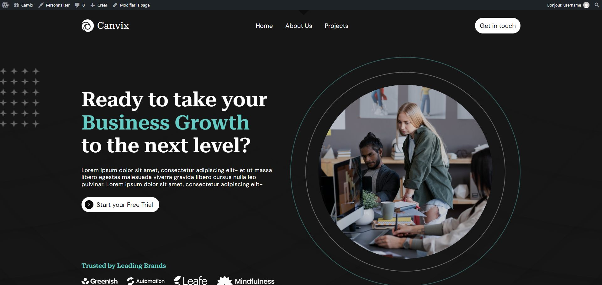
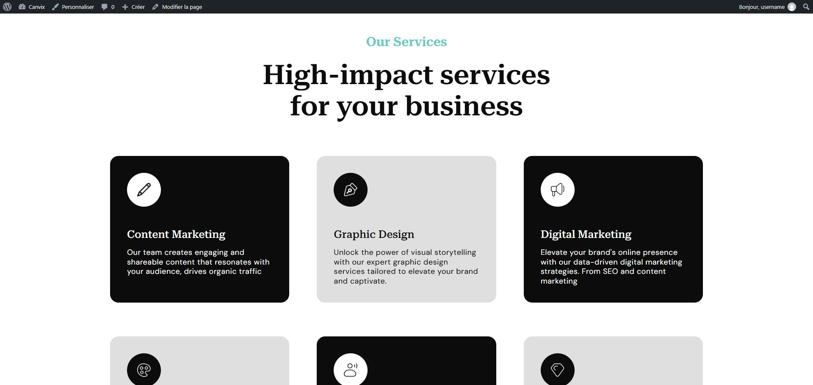
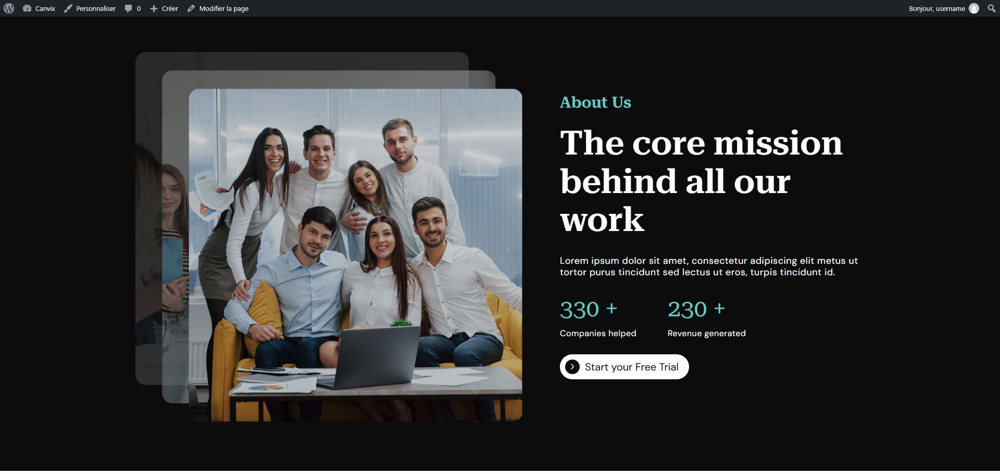
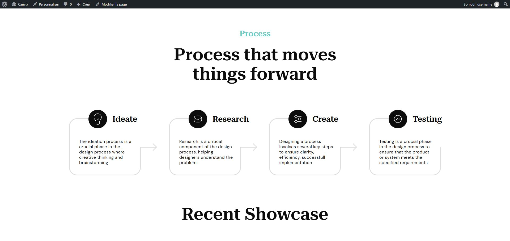
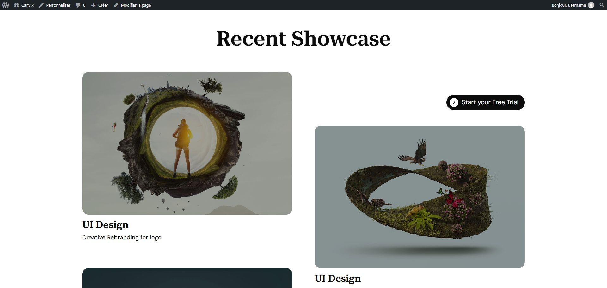
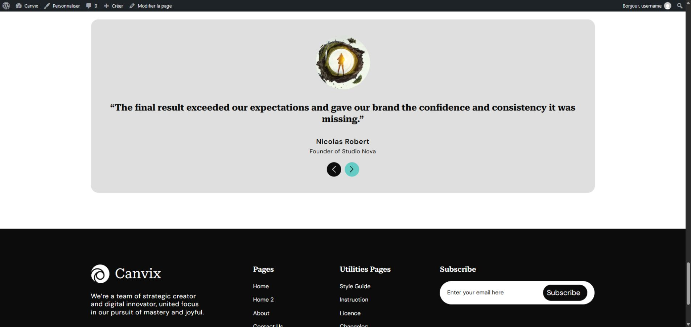
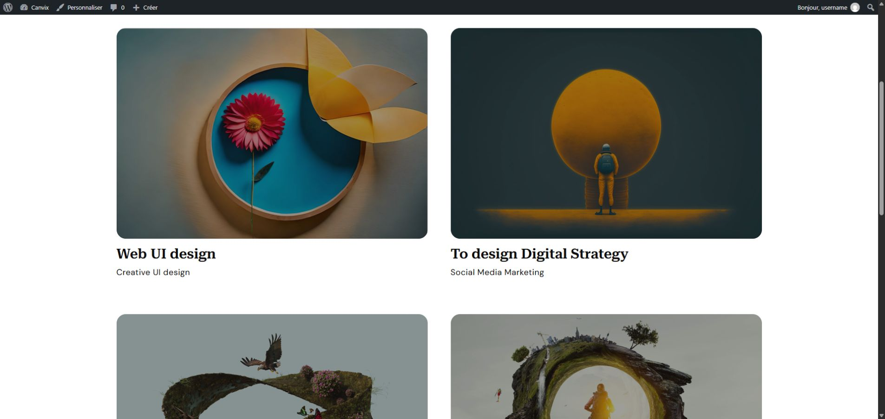
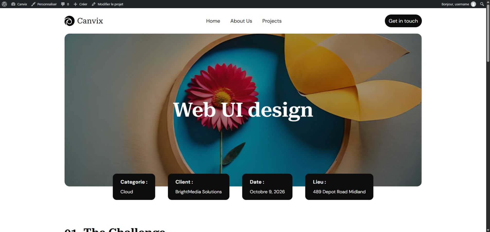
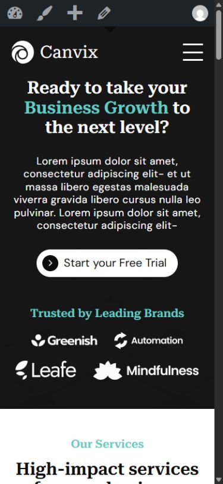

# Canvix — Thème WordPress personnalisé

**Projet personnel · Intégration responsive · Développement WordPress**

Canvix est un thème WordPress personnalisé pour un site vitrine d'agence. Il comprend une page d'accueil, une archive de réalisations et un modèle de page projet, avec des contenus administrables depuis WordPress.

À partir de la maquette [Free Template for Agency Website — Figma Community](https://www.figma.com/design/5ihJjC2eKj8FGFhh8Q0Pn1/Free-Template-for-Agency-Website--Community-?node-id=0-1), j'ai réalisé l'intégration responsive, le développement du thème et les interactions JavaScript.

**Technologies :** WordPress · PHP · Advanced Custom Fields (ACF) · HTML · SCSS / Sass · JavaScript natif · Vite · Git

**Environnement de développement :** [Local](https://localwp.com/) pour faire fonctionner WordPress sur mon ordinateur, et Vite pour compiler les styles SCSS et les scripts JavaScript.

## Aperçu du projet

Ces captures permettent de découvrir le site sans installation. Cliquer sur une image pour la consulter en grand.

<strong>Découvrir les autres sections de l'accueil</strong>

**Services — aperçu de la grille**

**Présentation de l'agence — About**

**Étapes de travail — Process**

**Projets récents — aperçu de la sélection**

**Témoignages**

| Archive des projets — aperçu des cartes | Page individuelle — en-tête et informations du projet |
| --- | --- |
|  |  |

<strong>Voir l'accueil sur mobile</strong>

## Ce que j'ai réalisé

| Page | Fonctionnalités intégrées |
| --- | --- |
| **Accueil** | Bannière d'introduction, partenaires, services, présentation de l'agence, étapes de travail, projets récents et témoignages. |
| **Archive des projets** | Liste des projets publiés et message lorsqu'aucun projet n'est disponible. |
| **Page individuelle d'un projet** | Image mise en avant, catégorie, client, date, lieu, contenu Gutenberg et sélection d'autres projets. |

J'ai également intégré l'en-tête et le pied de page communs, le menu mobile et un carrousel de témoignages en JavaScript.

Les pages About et Contact fournies dans la démonstration servent de supports aux contenus et aux menus. Les vues intégrées sont celles présentées dans le tableau ci-dessus.

## Des contenus administrables

L'administration permet de faire évoluer les contenus sans modifier les templates :

- **Créer et gérer les services, étapes de travail, projets et témoignages** grâce à des types de contenus personnalisés. L'ordre des services et des étapes est réglable.
- **Renseigner les informations structurées avec ACF** : textes de la bannière d'introduction, partenaires, présentation de l'agence et informations des projets.
- **Composer le détail d'un projet avec Gutenberg**, en associant textes, images et galeries.
- **Modifier les boutons et les informations du pied de page** depuis le personnalisateur WordPress.
- **Organiser la navigation** depuis les menus WordPress : un menu principal et deux menus de pied de page.

## Choix techniques

- **Centraliser les composants partagés** : une même carte projet sert à l'accueil, à l'archive et aux projets associés. Modifier son template met à jour ces trois usages. Les sections de l'accueil et le bouton partagé sont également séparés en composants.
- **Adapter la mise en page à l'espace disponible** : les styles SCSS sont organisés en variables, base, composants et mises en page. Flexbox, Grid et les règles responsive permettent d'ajuster les compositions sur ordinateur et mobile.
- **Contrôler les données affichées** : les champs facultatifs sont affichés sous condition. Par exemple, si le lieu d'un projet n'est pas renseigné, ni sa valeur ni son libellé ne sont affichés. Les textes, attributs et URL sont échappés selon leur contexte ; les réglages du personnalisateur sont nettoyés à l'enregistrement.
- **Prendre en compte la navigation clavier** : le menu mobile déplace le focus vers son premier lien à l'ouverture et le restitue au bouton après une fermeture avec Échap. Son état est transmis avec `aria-expanded`. Les témoignages restent visibles si le carrousel n'est pas initialisé.

## Repères dans le code

- [functions.php](functions.php) — Configuration du thème, déclaration des types de contenus et réglages du personnalisateur.
- [template-parts/cards/project.php](template-parts/cards/project.php) — Carte projet réutilisée dans les différentes pages.
- [single-projects.php](single-projects.php) — Champs facultatifs, rendu du contenu Gutenberg et requête des projets associés excluant le projet consulté.
- [src/js/menu.js](src/js/menu.js) — Ouverture et fermeture du menu mobile, états ARIA et gestion du focus.

## Consulter le projet en local

Une démonstration est fournie avec les contenus, les médias et les groupes ACF. Un script configure leur import sur un WordPress neuf.

Suivre le [guide d'installation](demo/INSTALLATION.md) pour consulter le site avec Local.

Développé par **Keven** à partir de la maquette Figma citée en introduction.
